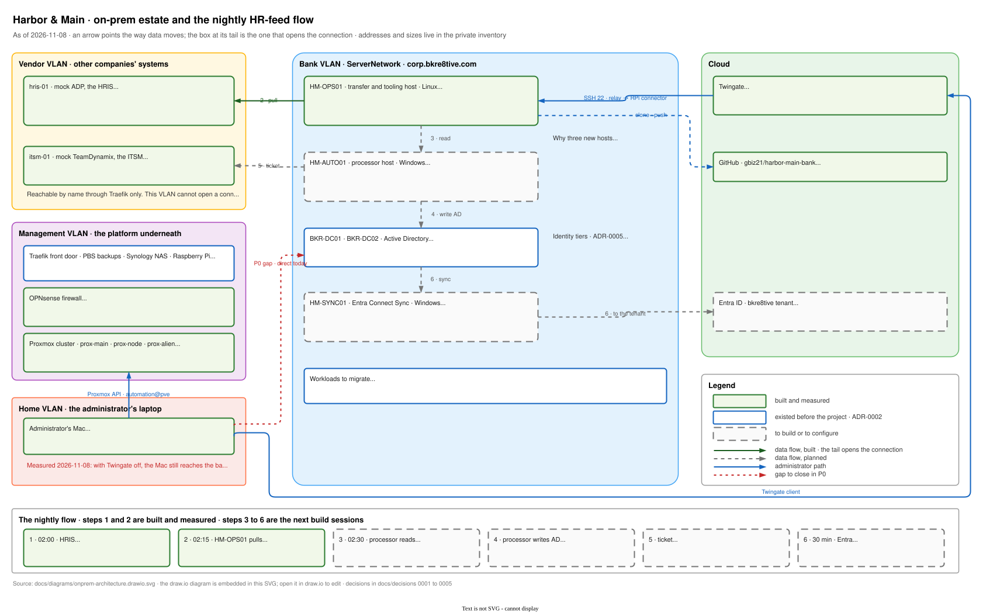

# On-prem architecture

> As of: 2026-11-08. Status: Phase 0 in progress. Addresses, VMIDs and sizes live in the private inventory, not here.

## Summary
Harbor & Main's on-prem estate is a small Windows domain on the bank VLAN, two vendor stand-ins on a separate vendor VLAN, and three single-purpose hosts that connect them: a Linux transfer and tooling host, a Windows automation host, and a Windows Entra Connect host. The directory, the file, application and database servers predate the project (ADR-0002). Everything new since 2026-11-07 was built through a scoped automation identity (ADR-0003), and the HR feed that drives joiner, mover and leaver handling is pulled from the vendor, never pushed in (ADR-0004).

## How this works
Payroll (stand-in: mock ADP on hris-01) writes a nightly roster to its own transfer area. At 02:15 the transfer host pulls new files with a bank-owned key against a pinned host key and lands them read-only for the processor. The processor (HM-AUTO01, to build) diffs the roster against Active Directory under a scoped service identity, creates, updates or disables accounts, and opens a ticket in the help-desk system (stand-in: mock TeamDynamix on itsm-01) for the human steps. Entra Connect on HM-SYNC01 (to configure) copies the staff OU to Entra ID, where group rules assign licences and mailboxes. Administrators reach the transfer host only through Twingate on port 22; the vendor VLAN cannot reach anything inside the bank, and the bank reaches the vendor on one port.

## Components and why
| Component | Purpose | Why this choice |
| --- | --- | --- |
| BKR-DC01, BKR-DC02 | Active Directory, DNS | the source of truth for identity; two so losing one is not an outage |
| BKR-FS01, BKR-APP01, BKR-SQL01, BKR-CL01 | shares, online-banking app, database, staff client | the workloads that get migrated; built before the project, finished in Phase 0 |
| hris-01 | mock ADP: roster, nightly report, read-only SFTP queue | the lab needs a vendor to pull from; real ADP works the same way |
| itsm-01 | mock TeamDynamix: TDX-shaped API and desktop | the human tasks of onboarding become tickets; the integration contract is proven before touching the real product |
| HM-OPS01 | Linux transfer and tooling host | one place that reaches out to vendors on a schedule and runs Terraform, Azure CLI and the pipeline tools; holds no directory rights |
| HM-AUTO01 | Windows automation host | the only identity that writes to the directory runs here as a gMSA scheduled task, never on a DC; later the Hybrid Runbook Worker |
| HM-SYNC01 | Entra Connect Sync | Microsoft requires a member server; it carries replication rights, so it does nothing else |
| OPNsense VLANs | vendor VLAN, bank VLAN, management VLAN | every rule change ships with an allow test and a deny test |
| Twingate | administrator access to the bank hosts | identity-checked, per-resource, per-port access instead of a flat VPN |

## Diagram

*Editable: open the SVG in draw.io; the diagram source is embedded. Arrows point the way data moves; the box at the tail opens the connection. The vendor VLAN initiates nothing toward the bank. Green = built and measured, blue = existed before the project, dashed = to build. The strip at the bottom is the nightly flow, steps 1 and 2 built, 3 to 6 next.*

## Validation checklist
- [x] Vendor VLAN blocked from bank, management and home VLANs; DNS and internet pass (2026-11-07)
- [x] mock ADP and mock TDX live behind Traefik, roster imported into the ITSM, API token issued and a wrong key refused (2026-11-07)
- [x] HM-OPS01 built through the automation identity; key-only SSH; guest agent; Twingate resource port 22 (2026-11-08)
- [x] Vendor queue: shell refused, write refused; pull lands files once, second run lands nothing (2026-11-08)
- [ ] Home VLAN blocked from bank and management VLANs; only the Twingate path works (P0-1)
- [ ] HM-SYNC01 and HM-AUTO01 renamed, addressed, domain-joined (step 3 of the Entra Connect journal)
- [ ] Processor reads landed roster as the read-only account and runs idempotently (HF-2)
- [ ] Entra Connect: in-scope user appears in Entra, out-of-scope and admin accounts do not (HF-3)
- [ ] SQL engine, app deployment, shares and backups on the BKR servers (P0-4 to P0-7)

## Decisions
See `decisions/`: 0001 one active phase, 0002 reuse the estate, 0003 scoped automation identity, 0004 pull not push, 0005 naming standard.
